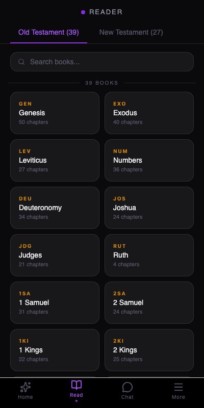
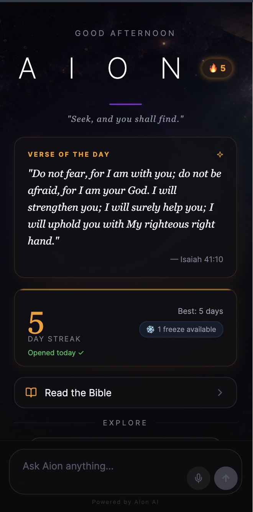
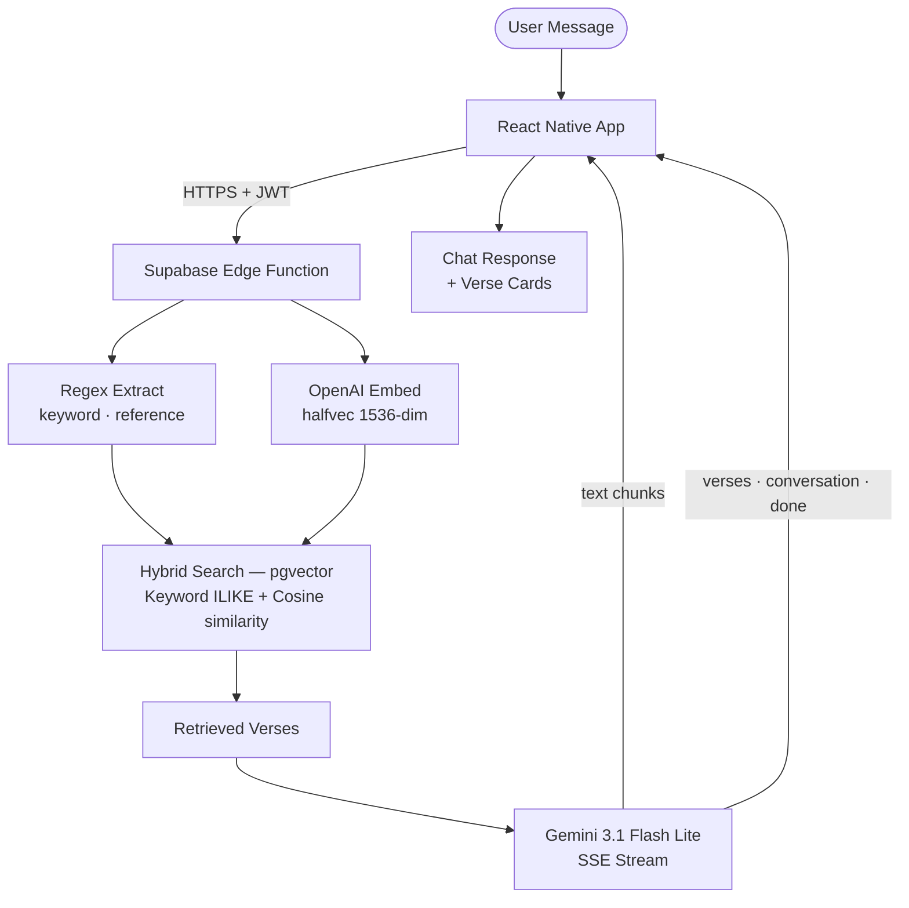

# Aion


[](https://doi.org/10.5281/zenodo.20522874)

AI-powered Bible companion using Agentic Hybrid RAG (Retrieval-Augmented Generation).

Users interact through a Perplexity-style chat interface with dynamic prompt suggestions and rich verse cards. All AI responses are grounded in actual Bible data retrieved via combined keyword and semantic search.

## Research: Aion-BibleQA

Aion is also the system under test for a small benchmark on **retrieval quality, citation faithfulness and false-premise robustness** in verse-grounded RAG.

- **Preprint (v1.0, as published):** [research/paper/latex/acl_latex.pdf](research/paper/latex/acl_latex.pdf) · DOI [10.5281/zenodo.20522874](https://doi.org/10.5281/zenodo.20522874)
- **Corrections:** [acl_latex_v1.1_draft.tex](research/paper/latex/acl_latex_v1.1_draft.tex) is a corrected source, labelled "v1.1 draft, corrects v1.0; not yet published". It has not been compiled or deposited. What it corrects is listed in [research/README.md](research/README.md#known-issues-in-preprint-v10-and-their-status-in-the-v11-draft).
- **Benchmark:** 40 questions across six categories, written and annotated by one person, the system's author ([gold_40 v0.3](research/datasets/aion_bibleqa_gold_40_v0.3.jsonl), [annotation guidelines](research/datasets/annotation_guidelines.md))
- **Harness, judges, frozen results:** [research/](research/README.md)

| Metric (gold_40 v0.3, v3 system) | Score |
| --- | --- |
| Recall@5 (34 retrieval questions) | 0.941 |
| MRR | 0.773 |
| Mean citation support (LLM judge, 0–1 rubric) | 0.978 |
| Unsupported citations (score < 0.5) | 0 / 34 |
| False-premise and adversarial refusals | 6 / 6 |

**How to read these figures.**

- These are development-set figures. There is no held-out split: the same 40 questions were used while building v1 to v3, and several accepted verse clusters were widened after looking at system output (the dataset's notes mark them, for example "retrieved by v1").
- The six refusals are four false-premise questions and two adversarial ones.
- The chat function passes up to six verses to the model; Recall@5 is computed over the first five.
- Recall@5 was 0.882 on gold_40 v0.2. The accepted verse clusters for two questions (`aion_023`, `aion_033`) were widened after looking at the v3 system's failures, which gives 0.941 on v0.3. The paper's Table 1 states this; the history is in [research/README.md](research/README.md).
- A retrieval question scores a hit if any of the top five verses is the gold verse or a member of its accepted cluster.
- Citation support is scored by an LLM judge from the same model family as the answering model, which the paper notes can inflate scores. The 0 / 34 figure uses a cutoff of 0.5, and one answer sits exactly on it.
- The 95% Wilson interval for Recall@5 (32 of 34) is [0.81, 0.98]. The published v1.0 prints [0.80, 0.97]; the v1.1 draft corrects it.
- The paper's cross-judge table cannot yet be recomputed from this repository: the raw GPT judge output was not committed (see "Artefact status" in [research/README.md](research/README.md)).
- Every figure in this section is recomputed from the frozen files and compared with the table above by [tests/research-headline-numbers.test.ts](tests/research-headline-numbers.test.ts), which runs in `./check.sh` and in CI. [research/README.md](research/README.md#where-each-number-comes-from) maps each number to its file.

**Recompute the headline numbers offline.** No API keys and no network access needed; the scripts read the frozen JSONL artefacts committed in `research/results/`:

```bash
npm ci
npm run research:metrics -- research/results/v3_direct_chapter_gold40_v03.jsonl   # R@5, P@5, MRR
npm run research:judge-report                                                     # citation support, refusals
```

**How it was built.** Much of the code was written with AI coding assistants working under the rules in [AGENT.md](AGENT.md); those commits carry `Co-Authored-By` trailers.

**Scope.** This is a pilot: 40 questions written by the system's author, one translation (BSB), single frozen runs over a non-deterministic IVFFlat index, and automated LLM judges rather than expert human annotation. The paper's Limitations section quantifies each of these. Open failures (`aion_027`, `aion_035`, `aion_036`) are listed in [research/README.md](research/README.md#open-failures).

## Features

- **Conversational Bible Q&A** — Ask questions in plain language and receive contextual answers grounded in scripture
- **Hybrid RAG retrieval** — Combines keyword matching and semantic vector search (pgvector) for precise verse lookup
- **Streaming responses** — Real-time SSE streaming from Gemini via Supabase Edge Functions
- **Bible reader** — Browse all 66 books, select chapters, and read with custom per-book background art
- **Rich verse cards** — Inline Bible verse display with book, chapter, and verse attribution
- **Verse highlights & bookmarks** — Colour-coded highlighting and bookmarking persisted per user
- **Voice-to-text** — Mic input via Web Speech API (web) or OpenAI Whisper through a server-side Edge Function (iOS/Android)
- **Text-to-speech** — Read-aloud support via platform TTS engines
- **Verse of the day** — A rotating verse on the home screen. `lib/notifications.ts` holds a browser-notification helper for it (web Notification API) that no screen calls yet; there is no native push
- **Prompt suggestions** — Dynamic suggestion pills on the home screen to inspire exploration
- **Conversation history** — Persistent chat history accessible from the More tab
- **Settings** — Font size and theme controls
- **Anonymous auth** — Zero sign-up friction; users are authenticated silently on first launch
- **Rate limiting & caching** — IP-based rate limits and exact-match response cache to control costs

## Screenshots

<div align="center">
  
  
  
  <br />
  <em>Reader, Chat, and Settings interfaces</em>
</div>

## Tech Stack

- **Frontend:** React Native + Expo + Expo Router
- **Desktop:** Tauri v2 (native macOS/Windows/Linux wrapper)
- **Backend:** Supabase (PostgreSQL + pgvector + Edge Functions)
- **Auth:** Supabase Anonymous Auth
- **Embedding Model:** OpenAI `text-embedding-3-small` (stored as `halfvec(1536)`)
- **Chat LLM:** Gemini 3.1 Flash Lite
- **Voice Transcription:** OpenAI Whisper (native platforms)
- **Data Source:** [bible.helloao.org](https://bible.helloao.org/docs/) (BSB translation)
- **Client Caching:** @tanstack/react-query

## Architecture



## Project Structure

```
Aion/
├── app/                            # Expo Router screens
│   ├── _layout.tsx                 # Root layout (auth + anonymous session)
│   ├── (tabs)/                     # Bottom tab navigation
│   │   ├── _layout.tsx             # Tab bar layout (Home / Read / Chat / More)
│   │   ├── index.tsx               # Home screen (VOTD + prompt pills)
│   │   ├── read.tsx                # Bible browser (book/chapter selection)
│   │   ├── chat.tsx                # Chat history list
│   │   └── more.tsx                # History + settings entry
│   ├── chat/
│   │   └── [id].tsx                # Active chat screen (streaming + verse cards)
│   └── reader/
│       ├── _layout.tsx             # Reader stack layout
│       └── [bookId]/
│           ├── index.tsx           # Chapter list for a book
│           └── [chapter].tsx       # Chapter reader with per-book backgrounds
├── components/                     # Shared React Native components
│   ├── BookArtTuner.tsx            # Dev tool: per-book background image tuner
│   ├── BookBackground.tsx          # Custom background renderer (transform + gradient)
│   ├── ChatBubble.tsx              # Message bubbles (user + assistant)
│   ├── ChatInput.tsx               # Text input + voice-to-text + send
│   ├── HistoryDrawer.tsx           # Legacy conversation history sidebar
│   ├── Onboarding.tsx              # First-launch onboarding flow
│   ├── PromptPill.tsx              # Suggestion prompt chips
│   ├── SettingsSheet.tsx           # Settings bottom sheet (font size, theme)
│   └── VerseCard.tsx               # Bible verse display card with copy
├── lib/                            # Shared utilities and hooks
│   ├── bible-data.ts               # OT/NT book lists, VOTD rotation logic
│   ├── bookBackgroundSettings.ts   # Per-book background settings (AsyncStorage)
│   ├── chat.ts                     # SSE streaming + Supabase API calls
│   ├── notifications.ts            # Daily verse browser-notification helper (not wired to a screen yet)
│   ├── settings.tsx                # App-wide settings (font size, theme)
│   ├── supabase.ts                 # Supabase client + isSupabaseConfigured helper
│   ├── theme.ts                    # Design system (colours, fonts, tokens)
│   ├── tts.ts                      # Text-to-speech engine (web + native)
│   ├── types.ts                    # TypeScript interfaces
│   └── utils.ts                    # Relative time formatting utility
├── assets/                         # Images and fonts
│   └── *.png                       # App icons + per-book background images (all 66 books)
├── src-tauri/                      # Tauri desktop app wrapper
│   ├── src/                        # Rust entry points
│   ├── icons/                      # App icons (all platforms)
│   └── tauri.conf.json             # Tauri configuration
├── scripts/
│   ├── ingest.ts                   # Full Bible ingestion pipeline (BSB + embeddings)
│   └── fix-incomplete.ts           # Targeted re-ingest for incomplete books
├── supabase/
│   ├── migrations/                 # 7 SQL migration files (see Setup)
│   └── functions/
│       ├── chat/index.ts           # RAG Edge Function (Deno runtime)
│       ├── record-open/index.ts    # Daily-streak recording
│       └── transcribe/index.ts     # Whisper proxy for native voice input
├── research/                       # Aion-BibleQA benchmark, harness, judges, frozen results, paper
├── tests/                          # Node.js test suite (tsx runner, 114 tests)
│   ├── bible-data.test.ts
│   ├── bible-reference-parser.test.ts
│   ├── bookBackgroundSettings.test.ts
│   ├── notifications.test.ts
│   ├── research-headline-numbers.test.ts  # Pins the research numbers to the frozen files
│   ├── research-metrics.test.ts
│   ├── settings.test.ts
│   ├── streak-helpers.test.ts
│   ├── supabase.test.ts
│   ├── tts.test.ts
│   └── utils.test.ts
├── check.sh                        # Quality gate: format → lint → type-check → test
└── docs/
    ├── API.md                      # Edge Function & PostgREST API docs
    ├── ARCHITECTURE.md             # System architecture & data flow
    ├── DEPLOYMENT.md               # Production deployment guide
    ├── ENVIRONMENT.md              # Environment variables list
    ├── SETUP.md                    # Local setup instructions
    ├── TESTING.md                  # Test suite documentation
    └── TROUBLESHOOTING.md          # Common development issues
```

## Setup

Please refer to the comprehensive setup instructions in [docs/SETUP.md](docs/SETUP.md).

## Development

```bash
# Quality gate (format + lint + type-check + tests)
./check.sh

# Type-check only
npm run type-check

# Lint
npm run lint

# Format
npm run format

# Run tests
npm test

# Run on iOS simulator
npx expo run:ios

# Run on Android emulator
npx expo run:android

# Run desktop app (dev mode)
npm run desktop

# Build desktop app (production)
npm run desktop:build
```

See [docs/TESTING.md](docs/TESTING.md) for details on the test suite and [docs/DEPLOYMENT.md](docs/DEPLOYMENT.md) for production deployment steps.

## Security

- **API keys server-side only:** OpenAI (embeddings and Whisper), Gemini and `service_role` keys are Edge Function secrets. Native voice input goes through the authenticated `transcribe` function, so no OpenAI key ships in the app
- **IP-based rate limiting:** chat 5/min burst, 30/3hrs per IP, 200/day global cap; voice transcription has its own limiter (5/min and 20/3hrs per user and per IP, 100/day global), charged only after the upload validates, plus a 2 MB body cap enforced while streaming
- **Response cache:** Exact-match queries served from DB at zero LLM cost
- **Message length cap:** 500 characters max to prevent token-stuffing
- **RLS enforced:** All tables protected; users can only access their own data
- **IDOR protection:** Conversation ownership verified before any write operation
- **SQL injection protection:** LIKE wildcards escaped in keyword search
- **Dev bypass:** Secret header for testing, excluded from production builds
- **Fail-closed:** Rate limit errors default to deny

## Contributing

Contributions are welcome. Please read [CONTRIBUTING.md](CONTRIBUTING.md) before opening a pull request.

## License

See [LICENSE](LICENSE) for details.
